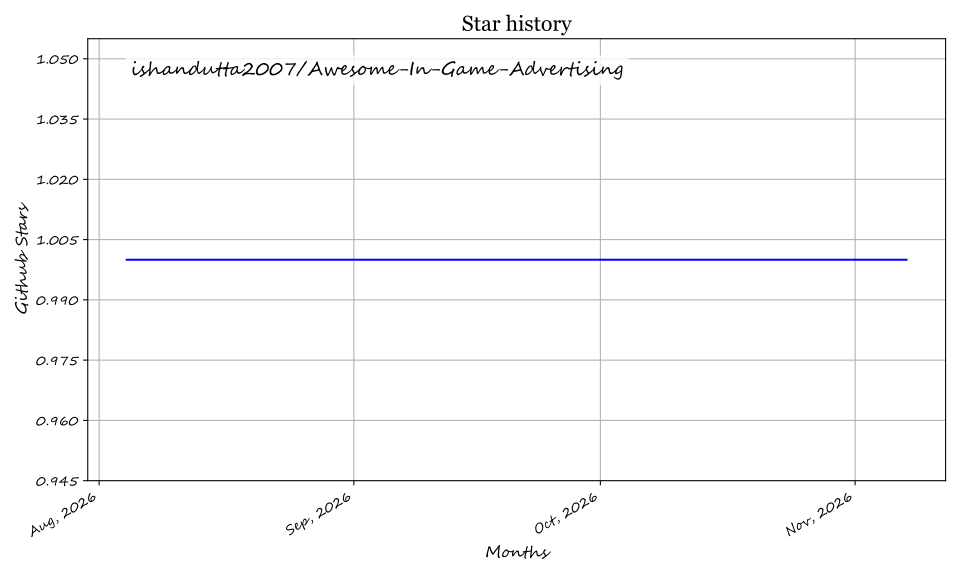

  

# 🎮 Awesome In-Game Advertising Platforms

**In-Game Advertising Platforms** enable game developers and publishers to monetize through dynamic, brand-safe ad placements inside games (banners, interstitials, rewarded video, audio, and especially immersive/3D in-game ads). Leading platforms include Google AdMob, AppLovin, Unity Ads, Mintegral, SuperAwesome, Anzu, Gadsme, Adverty, Odeeo, and PubScale.

Below is a **curated list** of notable platforms and their open-source equivalents. Fully featured open-source solutions for dynamic 3D in-game advertising are rare due to the complexity of real-time rendering, brand safety, and ad network integrations. Most open-source activity focuses on ad mediation, general ad servers, and SDK wrappers.

## 🏢 SaaS / Hosted Platforms

| Platform | Description | Pricing | Free Tier Limit | Company Size (Revenue/Valuation) |
| --- | --- | --- | --- | --- |
| **[Google AdMob](https://admob.google.com/)** | Major mobile and cross-platform ad network | Revenue Share | No limit | ~$305B (Alphabet Revenue) |
| **[Unity LevelPlay](https://unity.com/products/levelplay)** | Leading mobile ad mediation and monetization platform (formerly ironSource LevelPlay) | Free Mediation / Rev Share on Network | No limit | ~$4.4B (ironSource Merger Valuation) |
| **[AppLovin](https://www.applovin.com/)** | Major mobile and cross-platform ad network | Revenue Share | No limit | ~$3.3B Revenue |
| **[Unity Ads](https://unity.com/products/unity-ads)** | Major mobile and cross-platform ad network | Revenue Share | No limit | ~$2.2B Revenue |
| **[Mintegral](https://www.mintegral.com/)** | Programmatic AI-driven ad tech and monetization platform (Mobvista subsidiary) | Revenue Share | No limit | ~$2.05B Revenue (~$2.2B Market Cap) |
| **[Admix](https://admixplay.com/)** | In-game and interactive advertising platforms (merged with LandVault) | Custom / Revenue Share | N/A | ~$450M (Acquisition/Exit Valuation) |
| **[Chartboost](https://www.chartboost.com/)** | Major mobile and cross-platform ad network | Revenue Share | No limit | ~$250M (Acquisition) |
| **[Anzu](https://anzu.io/)** | Dynamic, immersive, and brand-safe in-game advertising | Custom / Revenue Share | N/A | ~$120M Valuation |
| **[SuperAwesome](https://www.superawesome.com/)** | Kid-safe in-game advertising and metaverse monetization (Roblox, Fortnite, Minecraft) | Custom / Campaign Budget | N/A | ~$100M+ Valuation (~$55M Revenue) |
| **[Venatus](https://www.venatus.com/)** | In-game and interactive advertising platforms | Custom / Revenue Share | N/A | ~$30M Revenue |
| **[Bidstack](https://www.bidstack.com/)** | Dynamic, immersive, and brand-safe in-game advertising | Custom / Revenue Share | N/A | ~$30M Valuation |
| **[Odeeo](https://odeeo.io/)** | In-game audio advertising platform for mobile games without interrupting gameplay | Custom / Revenue Share | No limit (Free SDK) | ~$25M - $50M Valuation (~$9M Revenue) |
| **[Frameplay](https://frameplay.com/)** | Dynamic, immersive, and brand-safe in-game advertising | Custom / Revenue Share | N/A | ~$11.8M Revenue (~$8M Funding) |
| **[PubScale](https://pubscale.com/)** | Immersive and native in-game advertising platform by GreedyGame | Custom / Revenue Share | No limit (Free SDK) | ~$8M - $12M Revenue (Parent Bootstrapped) |
| **[Adverty](https://adverty.com/)** | Seamless 3D In-Play and in-menu native game advertising (NGM: ADVT) | Custom / Revenue Share | No limit (Free SDK) | ~$9M Valuation (~$4M Revenue) |
| **[AdInMo](https://adinmo.com/)** | Dynamic, immersive, and brand-safe in-game advertising | Custom / Revenue Share | N/A | ~$8.2M Funding (~$3.5M Revenue) |
| **[Gadsme](https://gadsme.com/)** | Immersive in-game advertising platform backed by Galaxy Interactive and Ubisoft | Custom / Revenue Share | No limit (Free SDK) | ~$8M Funding (~$1M - $10M Revenue) |
| **[Adsun](https://adsun.io/)** | Rewarded and interstitial advertising for games built as Telegram Mini Apps; not a native or 3D in-game SDK | Custom / Performance-based (CPM/CPC) | No free tier (min. campaign spend / payout threshold) | ~$1M - $2M Revenue (11-50 employees) |

## 🔓 Open-Source Software

### 🔄 Ad Mediation & Mobile Game Monetization
- **[Prebid.js](https://github.com/prebid/Prebid.js)**  — Leading open-source header-bidding framework. Primarily web-focused but also supports mobile app monetization and can be part of a broader programmatic stack.
- **[Revive Adserver](https://github.com/revive-adserver/revive-adserver)**  — Mature, widely used open-source ad server for managing campaigns, banners, targeting, and reporting. Can be self-hosted and adapted for certain game inventory use cases.
- **[Google Mobile Ads Unity Plugin](https://github.com/googleads/googleads-mobile-unity)**  — The official open-source Google Mobile Ads (AdMob) plugin for Unity developers to deploy banner, interstitial, and rewarded ads.
- **[Godot AdMob Plugin](https://github.com/poingstudios/godot-admob-plugin)**  — Full-featured, open-source Google AdMob plugin for the Godot Engine supporting GDScript, C#, Android, iOS, and mediation.
- **[Prebid Server](https://github.com/prebid/prebid-server)**  — High-performance, open-source server-side auction engine written in Go, coordinating header bidding and app monetization.
- **[OpenAdServer](https://github.com/seanZhang414/openadserver)**  — A modern, self-hosted alternative to Google Ad Manager featuring ML-powered CTR prediction and real-time eCPM bidding.
- **[Unity Ads Android SDK](https://github.com/Unity-Technologies/unity-ads-android)**  — Official open-source Android SDK for integrating Unity Ads into Android mobile games.
- **[AppLovin MAX Unity Plugin](https://github.com/AppLovin/AppLovin-MAX-Unity-Plugin)**  — Open-source Unity plugin for AppLovin MAX mediation, supporting in-app bidding and ad network mediation adapters.
- **[GreenRobot Ad Server](https://github.com/greenrobotllc/adserver)**  — A PHP/Laravel-based system designed for yield optimization, specifically for rotating ads between networks like AdMob.
- **[Unity Ads iOS SDK](https://github.com/Unity-Technologies/unity-ads-ios)**  — Official open-source iOS SDK for integrating Unity Ads into iOS games.
- **[OpenMediation](https://github.com/OpenMediationProject/OpenMediation)**  — Fully open-source mediation platform with SDKs, server, and dashboard. Supports multiple major ad networks, waterfall optimization, and header bidding.
- **[Prebid Mobile Android](https://github.com/prebid/prebid-mobile-android)**  — Open-source Android SDK for Prebid Mobile, enabling header-bidding integration into mobile apps and games.
- **[Smoud Playable SDK](https://github.com/smoudjs/playable-sdk)**  — Open-source TypeScript SDK for creating cross-network HTML5 playable ads (supporting Google, AppLovin, Unity Ads, and MRAID).
- **[Eyevinn Test Adserver](https://github.com/Eyevinn/test-adserver)**  — Open-source test ad server tool for validating VAST/VMAP video advertising responses and client/server-side ad insertion workflows.
- **[Volt Adserver](https://github.com/krish512/volt)**  — A fast, modern open-source ad server built with GoLang.

### 🛠️ Supporting Tools & Building Blocks
- **[AdInMo Unity Plugin](https://github.com/AdInMo-Ltd/unity-plugin)** — Official Unity integration package for serving dynamic, contextual in-game brand placements and immersive 3D textures.
- **[PubScale Immersive Ads Unity](https://github.com/GreedyGame/immersive-ads-unity)** — Open-source Unity SDK for GreedyGame PubScale immersive in-game ad placements and non-intrusive monetization.
- **[App-Ads.txt Generator for Unity](https://github.com/gimilo/beamflow-unity-app-ads-txt)** — Unity Editor utility that auto-detects installed ad network SDKs and generates standard `app-ads.txt` compliance records.
- Open-source attribution and analytics tools that help measure ad-driven installs and in-game events.
- Custom ad-serving proxies and simple game-specific ad servers developed by the community for particular titles or engines.
- General advertising technology components (auction logic, creative serving, consent management) that developers can assemble into a custom in-game ad pipeline.

### 🧠 Reality Check
True dynamic 3D in-game advertising platforms (like Anzu or Bidstack) that handle real-time texture replacement, brand safety, and sophisticated inventory packaging remain largely proprietary. Most independent or smaller studios currently combine:

1. 💰 Commercial mediation / networks (AdMob, AppLovin, Unity Ads, etc.) for fill and demand
2. 🎛️ Open-source mediation layers (OpenMediation) or custom wrappers for control
3. 🏠 Self-hosted ad servers (Revive) for direct-sold or house inventory
4. ⚙️ Custom engine integrations for any special in-game placements

This hybrid approach gives developers more ownership while still accessing major advertiser demand.

---

**🤝 How to contribute**  
Fork this repository, add a new project (with link + short description + category), and open a pull request.  
Prefer actively maintained open-source projects related to in-game advertising, mobile ad mediation, ad servers, or game monetization SDKs.

**📄 License**  
This list is public domain / CC0. Feel free to copy into your own [awesome list](https://github.com/ishandutta2007/Awesome-Awesome-Awesome) or README.

⭐ Star the projects you find useful — open ad tools help game developers monetize more transparently! 🎮

## 💖 Support

Thank you for visiting and supporting this curated resource! If you find this list helpful, please consider:
- ⭐ **Starring** this repository to help others discover it
- 🍴 **Forking** and sharing it with other developers and gaming communities
- ☕ **Buy me a coffee**: Support ongoing curation and maintenance via the [GitHub Sponsors Dashboard](https://github.com/sponsors/ishandutta2007)

##  Star History

## ⭐ Star History

<a href="https://star-history.com/#ishandutta2007/Awesome-In-Game-Advertising&Timeline" align="center">
  <picture>
    <source media="(prefers-color-scheme: dark)" srcset="assets/ishandutta2007_Awesome-In-Game-Advertising_growth.svg">
    
  </picture>
</a>
